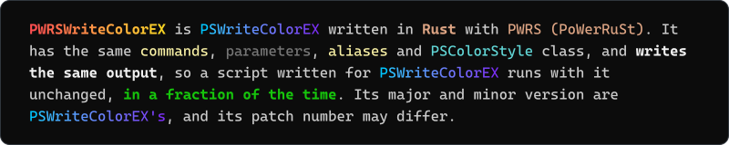
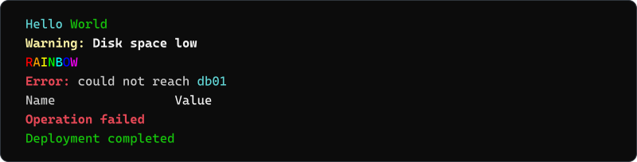

<div align="center">


[](https://www.powershellgallery.com/packages/PWRSWriteColorEX)
[](https://markusmcnugen.github.io/PSWriteColorEX/)
[](https://github.com/Variably-Constant/PWRSWriteColorEX/blob/main/LICENSE)
[](#platforms)
[](#platforms)

**[Documentation](https://markusmcnugen.github.io/PSWriteColorEX/)** | [Getting started](https://markusmcnugen.github.io/PSWriteColorEX/docs/tutorial/getting-started/) | [Write-ColorEX reference](https://markusmcnugen.github.io/PSWriteColorEX/docs/reference/write-colorex/) | [PWRSWriteColorEX](https://markusmcnugen.github.io/PSWriteColorEX/docs/explanation/pwrswritecolorex/) | [PSWriteColorEX](https://github.com/MarkusMcNugen/PSWriteColorEX) | [PWRS](https://github.com/Variably-Constant/PWRS)



</div>

---

<details>
<summary><b>Table of contents</b></summary>

- [Features](#features)
- [Quick start](#quick-start)
- [Commands](#commands)
- [Same output as PSWriteColorEX](#same-output-as-pswritecolorex)
- [Differences from PSWriteColorEX](#differences-from-pswritecolorex)
- [Performance](#performance)
- [How it is built](#how-it-is-built)
- [Building and testing](#building-and-testing)
- [Platforms](#platforms)
- [Wiki](#wiki)
- [Credits](#credits)
- [Use of AI tools](#use-of-ai-tools)
- [License](#license)

</details>

---

## Features

- TrueColor, 256 and 16 colors, and the console's colors where the terminal has no ANSI support, with the best mode the terminal has chosen for you. See [Terminal compatibility](https://markusmcnugen.github.io/PSWriteColorEX/docs/reference/terminals/).
- 129 color names in 44 families, hex codes, `rgb()`, `hsl()`, RGB arrays and color numbers, and names of your own with `Register-ColorName`.
- [Gradients](https://markusmcnugen.github.io/PSWriteColorEX/docs/tutorial/gradients/) across the text and its background, blended to the last bit as PSWriteColorEX blends them: in eight color spaces, with placed stops, easing curves, bands, repeats and four directions, twenty-one [named gradients](https://markusmcnugen.github.io/PSWriteColorEX/docs/reference/colors-and-names/#named-gradients) such as Sunset and Ocean, and `Get-GradientColor` for a gradient's colors.
- Markup tags such as `[bold red]Error:[/]`, patterns colored where they match, strings split into colored parts, and links terminals open when clicked.
- Bold, faint, italic, blink, reverse, crossed-out and overlined text, and underlines single, double, curly, dotted or dashed in a color of their own.
- Padding, centering, cutting and wrapping that count wide characters, such as CJK and emoji, as 2 cells.
- Style profiles (`PSColorStyle`), the built-in profiles behind the six message helpers, a default style, and profile files either module reads.
- [Themes](https://markusmcnugen.github.io/PSWriteColorEX/docs/how-to/use-a-theme/) that restyle the profiles: Catppuccin, Solarized, Gruvbox, Dracula, Nord, One Dark, Tokyo Night and PowerShell's own colors, and the CSS color names.
- `Format-ColorEX` for colored text as strings, and `Show-ColorTable` views of the color names, the text styles, the 256-color chart and the style profiles.
- A [cheat sheet](https://markusmcnugen.github.io/PSWriteColorEX/docs/reference/cheat-sheet/), also in PowerShell's help as `about_PWRSWriteColorEX`.
- Logging to a file under any of the 14 encoding names `-Encoding` takes, with the same bytes in Windows PowerShell 5.1 and PowerShell 7, and transcripts that record each line once.
- `NO_COLOR`, `FORCE_COLOR`, `CLICOLOR`, `CLICOLOR_FORCE` and `TERM=dumb` honored.

## Quick start

Install the module from the PowerShell Gallery, or build it as described in [Building and testing](#building-and-testing):

```powershell
Install-Module PWRSWriteColorEX -Scope CurrentUser
```

Then write some color:

```powershell
Import-Module PWRSWriteColorEX

Write-ColorEX -Text 'Hello ', 'World' -Color Cyan, Green
Write-ColorEX -Text 'Warning: ', 'Disk space low' -Color Yellow, White -Bold
Write-ColorEX -Text 'RAINBOW' -Gradient Red, Orange, Yellow, Green, Cyan, Blue, Magenta
Write-ColorEX -Markup '[bold red]Error:[/] could not reach [cyan]db01[/]'
Write-ColorEX -Text 'Name' -AutoPad 20 -Color Gray -NoNewLine; Write-ColorEX -Text 'Value' -Color White

Write-ColorError 'Operation failed'
Write-ColorSuccess 'Deployment completed' -LogFile 'deploy.log'
```



The [tutorial](https://markusmcnugen.github.io/PSWriteColorEX/docs/tutorial/getting-started/)
shows all examples with the colors and styles they write.

## Commands

| Command | Aliases |
|---|---|
| `Write-ColorEX` | `Write-Color`, `Write-Colour`, `Write-ColourEX`, `WC`, `WCEX`, `wcolor`, `wcolour` |
| `Write-ColorError` | `WCE`, `Write-ErrorColor`, `Write-ErrorColour`, `Write-ColourError`, `WError`, `wcerror` |
| `Write-ColorWarning` | `WCW`, `Write-WarningColor`, `Write-WarningColour`, `Write-ColourWarning`, `WWarning`, `WCWarn`, `wcwarning` |
| `Write-ColorInfo` | `WCI`, `Write-InfoColor`, `Write-InfoColour`, `Write-ColourInfo`, `WInfo`, `wcinfo` |
| `Write-ColorSuccess` | `WCS`, `Write-SuccessColor`, `Write-SuccessColour`, `Write-ColourSuccess`, `WSuccess`, `wcok`, `wcsuccess` |
| `Write-ColorCritical` | `WCC`, `Write-CriticalColor`, `Write-CriticalColour`, `Write-ColourCritical`, `WCritical`, `wccritical` |
| `Write-ColorDebug` | `WCD`, `Write-DebugColor`, `Write-DebugColour`, `Write-ColourDebug`, `WDebug`, `wcdebug` |
| `Format-ColorEX` | `FCEX`, `Format-ColourEX` |
| `Show-ColorTable` | `Show-ColourTable` |
| `Get-GradientColor` | `Get-GradientColour` |
| `New-ColorStyle` | `NCS`, `New-ColourStyle`, `New-Style`, `ncstyle` |
| `Set-ColorDefault` | `SCD`, `Set-ColourDefault`, `Set-DefaultColor`, `Set-DefaultColour` |
| `Get-ColorProfiles` | `GCP`, `Get-ColourProfiles`, `Get-Profiles`, `gcprofiles` |
| `Export-ColorProfile` | `Export-ColourProfile` |
| `Import-ColorProfile` | `Import-ColourProfile` |
| `Remove-ColorProfile` | `Remove-ColourProfile` |
| `Register-ColorName` | `Register-ColourName` |
| `Unregister-ColorName` | `Unregister-ColourName` |
| `Test-AnsiSupport` | `TAS`, `Test-ANSI` |
| `Measure-DisplayWidth` | `MDW`, `Get-DisplayWidth` |
| `Convert-HexToRGB` | `CHR`, `Hex2RGB` |
| `Convert-RGBToANSI8` | `CRA8`, `RGB2ANSI8` |
| `Convert-RGBToANSI4` | `CRA4`, `RGB2ANSI4` |
| `Get-ColorTableWithRGB` | `GCT`, `Get-ColorTable`, `Get-ColourTable` |
| `Get-LighterRGBColor` | `Lighten-RGBColor` |
| `Get-LighterColorName` | `Lighten-ColorName` |
| `Get-LighterANSI8Color` | `LA8`, `Lighten-ANSI8`, `Lighten-ANSI8Color` |
| `Get-ColorContrast` | `Get-ColourContrast` |

`[PSColorStyle]` resolves after `Import-Module`, with the static properties `Profiles` and `Default`, the static methods `GetProfile` and `InitializeDefaultProfiles`, and the instance methods `ToWriteColorParams`, `SetAsDefault`, `AddToProfiles` and `Clone`.

## Same output as PSWriteColorEX

Three suites hold the module to PSWriteColorEX, and CI runs them on every platform it tests:

- `tests/Surface.Tests.ps1` compares every command and the types it returns, every parameter (type, position, aliases, valid values, parameter sets), alias and `PSColorStyle` member with what PSWriteColorEX declares.
- `tests/Parity.Tests.ps1` runs the 717 calls in `tests/parity/cases.txt` against both modules, each in a process of its own, under eight color environments: TrueColor, 256 colors, 16 colors, `NO_COLOR`, `TERM=dumb`, `CLICOLOR=0`, `CLICOLOR_FORCE=1` with `TERM=dumb`, and the support the terminal reports. It compares each write to the host with its colors, each warning, error, verbose message and object, and the bytes of each log file, then compares the theme files and the help topic this module copies from PSWriteColorEX with PSWriteColorEX's.
- `tests/Transcript.Tests.ps1` checks that a transcript records each line once, as PSWriteColorEX does.

## Differences from PSWriteColorEX

- PowerShell 7 needs 7.4 or later, since the module's PowerShell 7 half is built for .NET 8. Windows PowerShell 5.1 works as with PSWriteColorEX.
- A `-Style` value PSWriteColorEX refuses is refused with the same message, except that a number written with a suffix, such as `5L`, is quoted as its value, `5`: PowerShell's parameter binding quotes the number as typed, and the module sees only the value.
- `-Debugging` writes the same messages. Without `-Verbose` they go to the host as verbose lines, which `4>` does not redirect. With `-Verbose` they are verbose records, as in PSWriteColorEX.
- When a log file cannot be written, the warning gives the reason in its own words, close to .NET's.
- The two modules cannot be imported into one session, since each defines `[PSColorStyle]`.

## Performance

Microseconds per call for both modules at 1.2.1, each call run 2,000 times after 200 warm-up calls with its output discarded, each module in a process of its own, in pwsh 7.6.7 on Windows 11 on an AMD Ryzen 9 7900X, with `FORCE_COLOR=3`:

| Call | PSWriteColorEX 1.2.1 | PWRSWriteColorEX 1.2.1 |
|---|---:|---:|
| `Write-ColorEX -Text 'Status: ', 'OK' -Color Gray, Green` | 705 | 139 |
| `Write-ColorEX -Text 'x' -Color '#FF8000' -Bold` | 611 | 128 |
| `Write-ColorEX -Text ('=' * 40) -Gradient Red, Blue` | 1,195 | 144 |
| `Write-ColorEX -Text '世界' -AutoPad 20` | 454 | 127 |
| `Write-ColorInfo 'message'` | 431 | 128 |

Each write to the host is one call into .NET, through PWRS's `Pipeline::write_host`, which writes the `HostInformationMessage` that `Write-Host` writes.

## How it is built

- `src/write.rs` is `Write-ColorEX`, step for step the same as PSWriteColorEX's, with `src/runs.rs` reading markup, splits and highlights into runs, and `src/helpers.rs` the `Write-Color*` helpers.
- `src/detect.rs` is `Test-AnsiSupport` and the color support detection, which on Windows turns on virtual terminal processing in the console as PSWriteColorEX does.
- `src/colors.rs` holds the color table and the conversions, with PowerShell's rounding of halves to even; `src/forms.rs` reads the color forms, `src/names.rs` the registered names, and `src/oklab.rs` blends gradients in OKLab and measures contrast.
- `src/width.rs` is `Measure-DisplayWidth`, from the table of the Rust crate [unicode-width](https://crates.io/crates/unicode-width) 0.2.2 and the emoji sequence rules, the same data PSWriteColorEX's is generated from. `tools/widthgen` writes `src/width_sets.rs` and PSWriteColorEX's table from that crate.
- `src/log.rs` writes the log file; `src/format.rs` is `Format-ColorEX`, `src/profiles.rs` the profile files and the themes, and `src/style.rs`, `src/convert.rs` and `src/gradient.rs` the style cmdlets, the conversion cmdlets and the gradients, the named ones among them.
- `themes/` holds copies of PSWriteColorEX's theme files, which `src/profiles.rs` builds into the library, and `en-US/about_PWRSWriteColorEX.help.txt` PSWriteColorEX's help topic under this module's name. CI adds the topic and the color notices in `THIRD-PARTY-NOTICES` to the module folder.
- `src/csharp/PSColorStyle.cs` is the `PSColorStyle` class, in C# beside the Rust because a PWRS class defined in Rust has no static properties, and `Profiles` and `Default` are static. `src/csharp/ModuleHooks.cs` registers `[PSColorStyle]` as a type accelerator at import, as PSWriteColorEX does, since PowerShell 7 loads the module's assembly in a load context of its own.
- `src/lib.rs` exports the module behind the `module` feature, on by default. The crate also builds as a Rust library whose color modules are public, for another PWRS module to link with `default-features = false`, which leaves out the module's exports.

## Building and testing

The module builds with [PWRS](https://github.com/Variably-Constant/PWRS) 0.7.0 from crates.io, published as `PoWerRuSt`, and `cargo pwrs` of the same release:

```text
cargo install cargo-pwrs --version 0.7.0 --locked
cargo pwrs build --release      # the module folder in target/pwrs/PWRSWriteColorEX
cargo pwrs test --release       # the Rust tests, then the Pester suites
```

`cargo pwrs test` runs the Pester suites in PowerShell 7, and on Windows in Windows PowerShell 5.1 as well. The parity suite needs a checkout of [PSWriteColorEX](https://github.com/MarkusMcNugen/PSWriteColorEX), named by `PSWRITECOLOREX`:

```text
git clone https://github.com/MarkusMcNugen/PSWriteColorEX ../PSWriteColorEX
PSWRITECOLOREX=../PSWriteColorEX/PSWriteColorEX.psd1 cargo pwrs test --release
```

Rust 1.98 or later, edition 2024, and pwsh 7.4 or later on the building machine.

The images at the top of this README are the built module's own output, drawn by a script that needs Python with fontTools:

```text
pwsh ./.github/readme/New-ReadmeImage.ps1
```

## Platforms

One module folder carries the native library of each platform under `runtimes/<rid>/native/`. `.github/workflows/ci.yml` builds each one and joins them with `cargo pwrs merge`:

| Platform | Built | Pester suites in CI |
|---|---|---|
| Windows x64 | on Windows | PowerShell 7 and Windows PowerShell 5.1 |
| Windows arm64 | on Windows x64, for arm64 | not run |
| Linux x64 | for glibc 2.35 with cargo-zigbuild | PowerShell 7 |
| Linux arm64 | for glibc 2.35 with cargo-zigbuild | not run |
| macOS arm64 | on macOS | PowerShell 7 |
| macOS x64 | on macOS arm64, for x64 | not run |
| FreeBSD x64 | in a FreeBSD 15.0 VM | PowerShell 7 |

The Linux libraries load on any distribution with glibc 2.35 or later. The x64 libraries are built for the baseline x86-64 CPU and the macOS arm64 library for the Apple A14, the oldest Apple Silicon core.

## Wiki

The [PSWriteColorEX documentation](https://markusmcnugen.github.io/PSWriteColorEX/) covers both modules: a tutorial, how-to guides, a reference for every command and parameter, and explanations, with every example run through the module and shown in the colors it writes. [PWRSWriteColorEX](https://markusmcnugen.github.io/PSWriteColorEX/docs/explanation/pwrswritecolorex/) there covers this module's platforms, differences and parity.

## Credits

- [PSWriteColorEX](https://github.com/MarkusMcNugen/PSWriteColorEX), the module this one matches, and whose design and behavior it follows.
- [PWRS](https://github.com/Variably-Constant/PWRS) binds the Rust cmdlets to PowerShell and builds the module.
- [unicode-width](https://crates.io/crates/unicode-width) gives the display width of each character.
- [SubEtha](https://github.com/Variably-Constant/SubEtha)'s `subetha-core` holds the registered color names in a `SwapCell`, which any thread reads without waiting.
- The themes take their colors from Catppuccin, Solarized, Gruvbox, Dracula, Nord, One Dark and Tokyo Night, and eleven named gradients come from [gradient-string](https://github.com/bokub/gradient-string); [THIRD-PARTY-NOTICES](https://github.com/Variably-Constant/PWRSWriteColorEX/blob/main/THIRD-PARTY-NOTICES) credits each with its license.
- The images at the top of this README draw their letters with [Cascadia Mono](https://github.com/microsoft/cascadia-code).

## Use of AI tools

The author used Claude (Anthropic) via the Claude Code CLI for code development assistance and documentation drafting during the preparation of this repository. All design decisions and the final content were determined by the author. The implementation and the tests were verified through zero-warning `cargo clippy`, the Rust unit tests, and the Pester suites, the parity suite against PSWriteColorEX among them, in PowerShell 7 and Windows PowerShell 5.1.

## License

MIT, as written in [`LICENSE`](https://github.com/Variably-Constant/PWRSWriteColorEX/blob/main/LICENSE).
